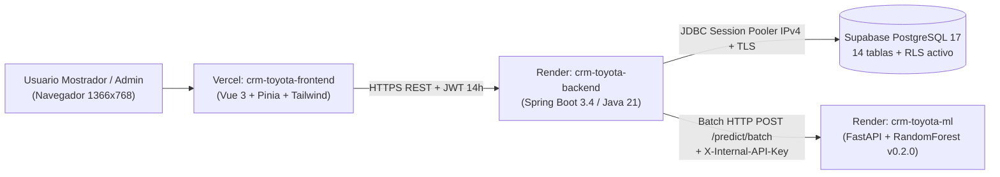

# Guía Integral del Sistema CRM-TOYOTA (Manual para el Equipo y Defensa Oral)

> **Audiencia:** Equipo del proyecto — **Jorge Chipoco** (ML Engineer), **Aaron Felices** (QA & Auditor PMBOK) y **Farid Briceño** (Tech Lead / Full-Stack).  
> **Propósito:** Reunir en un solo documento todo lo que necesitas saber para usar el sistema en producción, entender cómo se conecta tu parte con el resto, correr pruebas y responder con solvencia cualquier pregunta del profesor o de los talleres entrevistados.

---

## 1. El Sistema en 60 Segundos

**CRM-TOYOTA** es una plataforma web de ventas y control de inventario pensada para **talleres automotrices pequeños especializados en Toyota en Lima (Fase 1: Mostrador)**.

### Qué SÍ hace el sistema (Alcance cerrado Fase 1)
1. **Registro rápido de Clientes y Vehículos (`1 Cliente : N Vehículos`):** Alta por DNI/RUC con validación obligatoria de consentimiento **Ley N.º 29733** y detección automática de cliente existente para no duplicarlo si trae un segundo Toyota.
2. **Catálogo de Repuestos OEM + Equivalentes:** Búsqueda instantánea por SKU, código OEM común (`oem_reference_code`: Toyota OEM, Denso, Aisin, Alternativo), modelo Toyota (`Yaris`, `Corolla`, `Hilux`, `RAV4`, `Avanza`), año y versión.
3. **Cotizador POS Mostrador (`1366x768`, sin scroll horizontal, meta `< 3 min`):**
   - **Sugerencia inteligente de Kits Preventivos (`EXT01`)** según modelo y kilometraje del vehículo.
   - **Tarifario de Mano de Obra** con precios estándar Toyota.
   - **Autoguardado cada 5 segundos** en `LocalStorage` para no perder cotizaciones por cortes o cierres accidentales.
   - **Proforma PDF en `< 3 segundos`** (OpenPDF) y **envío directo por WhatsApp (`EXT02`, `wa.me`)**.
4. **Control Atómico de Stock y Ciclo de Cotizaciones:** Bloqueo informativo `HTTP 409` con sugerencia de repuesto equivalente en 1 clic si falta stock, reversión atómica de stock al anular una cotización aprobada, y registro de motivos de rechazo para medir **Ventas Perdidas (`EXT03`)**.
5. **Reposición Rápida de Almacén (`EXT04`) y Dashboard de Alertas ML:** Pronóstico semanal de demanda con **Random Forest Regressor** ejecutado en lote (*batch*), semáforo híbrido (`CRITICO`, `ALERTA`, `NORMAL`), Punto de Reorden (`ROP`) y compra sugerida.
6. **Marca Blanca Configurable (`workshop_settings`):** El nombre del taller, RUC, dirección, teléfono y lema se editan en vivo desde **Configuración** (rol `ADMIN`) sin tocar código, ideal para demostrar el sistema a distintos talleres.

### Qué NO hace (Exclusiones intencionales de Fase 1 — saber explicarlo)
- **NO emite boletas ni facturas SUNAT:** Las proformas (`COT-2026-XXXXX`) tienen vigencia de **7 días calendario** sin valor tributario; su estado final comercial es `CERRADA` (nunca *"Facturada"*).
- **NO gestiona órdenes de trabajo en bahía** (mecánicos asignados, tiempos de elevador) ni pasarelas de pago online ni encuestas post-servicio.
- **NO usa Microsoft Azure:** Se descartó definitivamente (`ADR-006`) porque la suscripción *Azure for Students Starter* expiró y bloqueó la reactivación. Todo opera hoy en **Ruta B Cloud (`S/ 0.00`)**.

---

## 2. Accesos en Vivo y Repositorios

### URLs en Producción (Activas hoy)
| Servicio | Plataforma (`S/ 0.00`) | URL en Vivo |
| :--- | :--- | :--- |
| **Aplicación Web (Frontend Vue 3)** | Vercel | https://crm-toyota-frontend.vercel.app |
| **API Backend (Spring Boot 3.4)** | Render Docker | https://crm-toyota-backend.onrender.com |
| **Swagger / OpenAPI del Backend** | Render Docker | https://crm-toyota-backend.onrender.com/swagger-ui.html |
| **Microservicio ML (FastAPI)** | Render Docker | https://crm-toyota-ml.onrender.com/docs |
| **Base de Datos PostgreSQL 17** | Supabase (`us-west-2`) | Proyecto `cowbnhbvctewgznicrde` (Session Pooler IPv4 + RLS) |

### Credenciales de Prueba (Misma clave para los 3 roles: `Toyota2026!`)
| Rol | Usuario | Contraseña | Permisos y Tope de Descuento |
| :--- | :--- | :--- | :--- |
| **Administrador** | `admin` | `Toyota2026!` | Acceso total, tope de descuento **15%**, botón *Recalcular Demanda ML*, Configuración Marca Blanca |
| **Recepcionista** | `recepcion` | `Toyota2026!` | Mostrador POS, Clientes/Vehículos, Cotizaciones, consulta de stock, tope de descuento **5%** |
| **Almacén** | `almacen` | `Toyota2026!` | Dashboard de Alertas ML y reposición rápida de stock (`+ Reponer Stock`); no cotiza |

> **Aviso crítico antes de demos o entrevistas (Cold Start de Render Free):**  
> En el plan gratuito de Render, si el Backend o el ML no reciben tráfico durante 15 minutos, los contenedores entran en reposo y tardan **30 a 50 segundos** en despertar. **1 minuto antes de presentar**, abre estas dos pestañas hasta ver `UP` y `ok`:
> 1. https://crm-toyota-backend.onrender.com/actuator/health  
> 2. https://crm-toyota-ml.onrender.com/health

### Organización GitHub (4 Repositorios Independientes)
Todos viven bajo `https://github.com/Gerencia-de-proyectos-en-computacion`:
- `crm-toyota-frontend` — Vue 3 (`<script setup lang="ts">`) + Pinia + Tailwind + Vitest.
- `crm-toyota-backend` — Java 21 + Spring Boot 3.4 + Spring Security (JWT 14h + BCrypt) + Flyway + OpenPDF + JaCoCo.
- `crm-toyota-ml` — Python 3.11 (`uv`) + FastAPI + scikit-learn (`RandomForestRegressor`) + Pytest.
- `crm-toyota-docs` — Documentación PMBOK, ADRs, matriz de trazabilidad, colección Postman y esta guía.

---

## 3. Arquitectura del Sistema



### Decisión de rendimiento clave: ML Batch vs. Lectura Rápida
- El microservicio ML **nunca se llama en tiempo real mientras se cotiza en mostrador**.
- Cuando el `ADMIN` presiona **"Recalcular Demanda ML"** (o mediante ejecución semanal programada), el Backend envía los 16 SKUs en un solo lote (`POST /predict/batch`), recibe predicciones + `reorder_point` + métricas (`GET /metrics`), y **persiste todo en PostgreSQL (`demand_forecasts` y `ml_model_runs`)**.
- Cuando Almacén o Admin abren el Dashboard ML, Spring Boot lee directamente de PostgreSQL en **< 500 ms**. Además, si el contenedor ML estuviera caído, el Backend tiene un *circuit/fallback* controlado (`MockMlForecastClient`) para no romper la operación.

---

## 4. Reglas de Negocio Innegociables

1. **Moneda e IGV (Perú):** Todo precio en catálogo está en Soles (`S/`) y **ya incluye el 18% de IGV**. El sistema aplica el descuento por rol sobre el bruto y muestra informativamente:
   - `Base Imponible = Total Final / 1.18`
   - `IGV (18%) = Total Final - Base Imponible`
2. **Máquina de Estados de Cotización y Stock Atómico (`@Transactional` + `@Version`):**
   - `PENDIENTE`: Editable libremente. No toca el inventario. Vigencia automática de 7 días.
   - `PENDIENTE ➔ APROBADA`: Descuenta stock de forma atómica con bloqueo optimista (`@Version`). Si cualquier ítem no tiene stock suficiente, **NO la rechaza automáticamente**: responde **`HTTP 409 Conflict`** indicando qué ítem falló y listando repuestos equivalentes con el mismo `oem_reference_code` que sí tienen stock para sustituir en 1 clic.
   - `PENDIENTE ➔ RECHAZADA`: No toca stock. Exige motivo obligatorio (`FALTA_STOCK`, `PRECIO`, `TIEMPO_ESPERA`, `OTRO`).
   - `APROBADA ➔ RECHAZADA`: Reversión permitida con motivo obligatorio; **reintegra atómicamente el stock** al inventario y deja registro en `inventory_movements` (kardex).
   - `APROBADA ➔ CERRADA`: Estado final exitoso de mostrador.
3. **Semáforo Híbrido de Inventario:**
   - `CRITICO` (Rojo): `stock == 0`, o `stock <= min_stock`, o `stock <= ceil(reorder_point * 0.5)`.
   - `ALERTA` (Amarillo): No es crítico y `stock <= reorder_point`.
   - `NORMAL` (Verde): `stock > reorder_point`.
4. **Sesión sin fricción:** El token JWT dura **14 horas** con renovación silenciosa (*sliding refresh*) para que al recepcionista no se le cierre la sesión en medio de una atención.
5. **Protección de Datos (Ley N.º 29733):** No se permite registrar ningún cliente sin marcar el consentimiento expreso (`dataConsentAccepted = true`); el Backend rechaza con `HTTP 400` si viene falso.

---

## 5. Sección Especial para Jorge Chipoco (ML Engineer)

### Qué se integró de tu microservicio y qué evolucionó a `v0.2.0`
Se respetó al 100% tu estructura original de FastAPI (`POST /predict`, `POST /predict/batch`, `GET /health` y las 12 features de entrada `PredictionRequest`) para no romper tu diseño, y se incorporaron los ajustes acordados para producción:
1. **Homologación de SKUs (`CRM_SKU_HOMOLOGATION`):** El modelo sigue entrenado sobre `REP-001..REP-020`, pero ahora acepta directamente los SKUs reales del catálogo Toyota (`AIS-PAD-0D1`, `TOY-FIL-0L0`, `DEN-AIR-178`, etc.) traduciéndolos internamente y conservando `HTTP 422` para códigos desconocidos.
2. **Nuevos campos y endpoints:**
   - Cada predicción incluye ahora `reorder_point` calculado con stock de seguridad.
   - Se añadió `GET /metrics` leyendo `models/metrics.json` para que el Backend muestre métricas reales en el Dashboard.
   - Autenticación opcional por cabecera `X-Internal-API-Key` (`ML_INTERNAL_API_KEY`) para proteger la comunicación Backend ➔ ML en la nube.
3. **Calibración del dataset sintético (`v0.1.0 ➔ v0.2.0`) — MUY IMPORTANTE para tu defensa:**
   - En `v0.1.0`, los ceros de demanda intermitente se generaban con un lanzamiento aleatorio no observable (`rng.random() < p`), lo que limitaba el modelo a `R²: 0.2478` y `WAPE: 104.90%`.
   - En `v0.2.0` (`scripts/generate_dataset.py`), se modeló el comportamiento real de reposición intermitente del taller usando reglas observables sin fuga de datos temporal (*zero temporal leakage*, validado por el test unitario `test_features_no_current_week_leakage`).
   - **Resultados verificados en producción (`v0.2.0`):**
     - **ADI (Average Demand Interval):** `1.50 – 2.14` en los 20 SKUs (todos `>= 1.32`, demostrando demanda intermitente real).
     - **`R²`:** **`0.9682`** (meta `>= 0.80`).
     - **`WAPE` (métrica principal):** **`9.76%`** (meta `<= 15%`).
     - **`MAPE` (solo semanas con demanda > 0):** **`9.07%`**.
     - **`RMSE`:** **`1.1449`** (frente a la línea base de media móvil: `R²: -0.084`, `WAPE: 82.26%`).

### Comandos rápidos para ti (`crm-toyota-ml`, PowerShell)
```powershell
cd crm-toyota\ml-service
uv run pytest -v                                # Ejecuta los 6 tests (incluye verificación anti-leakage)
uv run python scripts/generate_dataset.py       # Regenera dataset sintético intermitente
uv run python scripts/train_model.py            # Reentrena random_forest.joblib y metrics.json
uv run uvicorn app.main:app --reload --port 8000
```

---

## 6. Sección Especial para Aaron Felices (QA & Auditor PMBOK)

### Cómo correr la Auditoría Caja Negra en Postman (3 minutos)
En el repositorio `crm-toyota-docs` tienes listos los dos archivos en `qa/postman/`:
1. **Colección:** `qa/postman/CRM-TOYOTA.postman_collection.json`
2. **Entorno Producción (nuevo):** `qa/postman/CRM-TOYOTA-Prod.postman_environment.json`

**Pasos en Postman:**
1. Importa ambos archivos JSON en Postman.
2. Selecciona arriba a la derecha el entorno **`CRM-TOYOTA — Producción (Render + Supabase + Vercel)`**.
3. Abre primero `https://crm-toyota-backend.onrender.com/actuator/health` para despertar Render si estuvo inactivo.
4. Ejecuta la colección con **Collection Runner**:
   - Valida login de los 3 roles (`ADMIN`, `RECEPCIONISTA`, `ALMACEN`), JWT y topes de descuento.
   - Valida rechazo `HTTP 400` cuando falta consentimiento **Ley N.º 29733**.
   - Valida bloqueo `HTTP 409 Conflict` con equivalentes OEM al aprobar la cotización con quiebre (`COT-2026-00042`).
   - Valida generación de PDF (`< 3s`) y lectura del Dashboard ML (`< 500ms`).

### Evidencias de Calidad y Cobertura ya Verificadas
| Capa | Suite de Pruebas | Resultado |
| :--- | :--- | :--- |
| **Backend (`crm-toyota-backend`)** | JUnit 5 + Mockito + MockMvc + JaCoCo | `6/6` tests en verde • Cobertura **`96.58%`** instrucciones / **`99.15%`** líneas en `service` (meta `>= 95%`) |
| **Frontend (`crm-toyota-frontend`)** | Vitest + Vue TypeScript (`vue-tsc`) | `5/5` tests en verde • Build de producción sin errores • Cero scroll horizontal a `1366x768` |
| **ML (`crm-toyota-ml`)** | Pytest | `6/6` tests en verde (contratos `/health`, `/predict`, `/predict/batch`, `/metrics`, homologación y cero *data leakage*) |

### Documentos clave para tus entregas PMBOK
- **¿Dónde está cada función del informe en el código?** ➔ [PMBOK_CODE_TRACEABILITY.md](./PMBOK_CODE_TRACEABILITY.md)
- **Doble Presupuesto (Real `S/ 0.00` vs. Ideal Comercial PYME)** ➔ Sección 2 de [PMBOK_CODE_TRACEABILITY.md](./PMBOK_CODE_TRACEABILITY.md)
- **Backlog MoSCoW Sprint 1 y Sprint 2** ➔ [PRODUCT_BACKLOG_MOSCOW.md](./PRODUCT_BACKLOG_MOSCOW.md)
- **ADRs (incluye ADR-006 sobre el descarte de Azure)** ➔ [BUSINESS_RULES_AND_ADRS.md](./BUSINESS_RULES_AND_ADRS.md)

---

## 7. Guion de Demo en Vivo (5 Minutos) y Defensa Oral

### Secuencia ganadora para presentar al profesor o a un taller
1. **Login + Marca Blanca (`0:30`):** Entra como `admin` (`Toyota2026!`). Muestra en **Configuración** cómo el taller puede poner su propio nombre/RUC y se refleja al instante en cabecera y PDFs.
2. **Mostrador POS + Kit Preventivo (`1:30`):** En **Mostrador POS**, selecciona el Yaris `ABC-123`, haz clic en **"Sugerir Kit Preventivo"** (`EXT01`), agrega mano de obra, muestra el desglose automático de IGV (18% incluido), guarda la proforma, descarga el **PDF** y muestra el botón de **WhatsApp (`wa.me`)**.
3. **Bloqueo `409 Conflict` y Sustitución OEM (`1:00`):** Ve a **Cotizaciones**, intenta aprobar la proforma `COT-2026-00042` (pide pastillas Aisin con stock `0`). Muestra el modal rojo que **no rechaza la venta**, sino que ofrece sustituir por las pastillas equivalentes Denso (mismo código OEM `04465-0D150`) con 1 clic y aprobar atómicamente.
4. **Dashboard ML en Vivo (`1:30`):** Ve a **Alertas ML**, enseña las métricas reales (`R²: 0.97`, `WAPE: 9.8%`, `MAPE (>0): 9.1%`, `ADI: 1.6`, `Fuente: FASTAPI_RF`), los KPIs de **Ventas Perdidas (`S/ 375.00`)** y **Tasa de Conversión**, presiona **"Recalcular Demanda ML"** para demostrar la llamada real al contenedor FastAPI, y realiza una reposición rápida con **`+ Reponer Stock`**.
5. **Trazabilidad y Pruebas (`0:30`):** Muestra brevemente Swagger (`/swagger-ui.html`) y la matriz `PMBOK_CODE_TRACEABILITY.md`.

### Preguntas difíciles del profesor y cómo responderlas
- **"¿El Machine Learning es real o son datos inventados en el frontend?"**  
  Es real y está desacoplado en su propio contenedor Docker en Render (`crm-toyota-ml`, FastAPI + `scikit-learn` `RandomForestRegressor` cargado desde `random_forest.joblib`). Al pulsar *"Recalcular Demanda ML"*, Spring Boot envía el lote a FastAPI, persiste el pronóstico en Supabase y el banner muestra `Fuente: FASTAPI_RF` con la marca de tiempo real.
- **"¿Por qué usan WAPE y ADI en vez de reportar solo MAPE?"**  
  En talleres automotrices los repuestos tienen **demanda intermitente** (semanas con venta `0`, verificado con `ADI >= 1.32`). El `MAPE` estándar se indefine o explota al dividir entre cero; por eso usamos **`WAPE`** como métrica principal agregada (`9.76%`) y reportamos **`MAPE`** únicamente sobre semanas donde la demanda real es `> 0` (`9.07%`).
- **"¿Qué pasa si dos recepcionistas aprueban al mismo tiempo la última unidad de un repuesto?"**  
  La tabla `parts` utiliza **control de concurrencia optimista (`@Version`)** dentro de una transacción `@Transactional`. Solo la primera aprobación confirma y descuenta; la segunda detecta el cambio de versión o stock insuficiente y bloquea con `HTTP 409`, garantizando cero stock negativo.
- **"¿Por qué no desplegaron en Azure si lo mencionaron antes?"**  
  Documentado en el **ADR-006**: la suscripción gratuita *Azure for Students Starter* expiró y Microsoft bloqueó su reactivación sin tarjeta comercial. Para no detener el cronograma y mantener el piloto en `S/ 0.00`, migramos los contenedores Docker portables a **Ruta B** (Vercel + Render Docker + Supabase PostgreSQL), manteniendo además el presupuesto ideal comercial documentado para la propuesta PYME.
- **"¿Por qué no emiten factura electrónica SUNAT?"**  
  Por control de alcance de Fase 1 (Mostrador): integrar OSE/SEE de SUNAT requiere certificado digital comercial y RUC activo. El sistema emite proformas comerciales con vigencia de 7 días y desglose informativo de IGV, dejando la integración tributaria como evolución natural de Fase 2.
